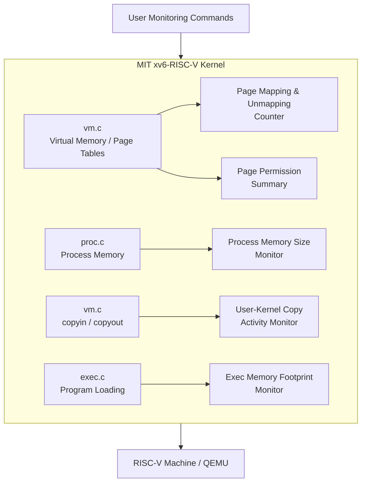
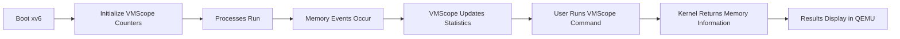

# VMScope-Virtual-Memory-Address-Space-Monitoring-for-xv6-RISC-V
# VMScope — Virtual Memory & Address-Space Monitoring for xv6-RISC-V

> **Operating Systems Project Proposal**  
> **Student:** Sahiba  
> Base Kernel: **MIT xv6-RISC-V**

---

## Project Overview

**VMScope** is an Operating Systems project based on the official **MIT xv6-RISC-V kernel**.

The project will extend xv6 with **5 proposed lightweight kernel modules** focused on process memory usage, page mapping activity, user-kernel memory transfers, program memory footprint, and page permissions.

The goal is to observe important virtual-memory behavior without redesigning the original xv6 page-table or memory-management system.

---

## Proposed 5 Modules

### 1. Process Memory Size Monitor
Tracks the current memory size of xv6 processes and shows how much virtual address space each process is using.

### 2. Page Mapping & Unmapping Counter
Counts how many memory pages are mapped and unmapped while xv6 is running.

### 3. User-Kernel Copy Activity Monitor
Tracks `copyin()` and `copyout()` operations and records how often data is transferred between user space and kernel space.

### 4. Exec Memory Footprint Monitor
Records basic memory information when a new program is loaded through `exec()`.

### 5. Page Permission Summary
Shows a simple summary of page-table permissions such as readable, writable, executable, and user-accessible mappings.

---

## System Architecture



---

## Working Flow



---

## Final Goal

```text
MIT xv6-RISC-V
      +
5 Virtual Memory Monitoring Modules
      =
VMScope Enhanced xv6 Kernel
```

The project is designed to remain simple enough to implement and explain while still demonstrating important Operating Systems concepts such as virtual memory, page tables, process address spaces, memory permissions, and user-kernel data transfer.

---

## Current Status

**Status:** Project Selection / Planning Stage  
**Implementation:** Not started yet  
**Next Step:** Run the original xv6 kernel successfully and then implement each VMScope module one by one.
